<div align="center">



<br />

[](https://github.com/md1qamar)
[](https://github.com/md1qamar?tab=followers)
[](https://github.com/md1qamar/bugcast)
[](https://github.com/md1qamar/smokeproof)
[](https://github.com/md1qamar/skillvet)

**Local-First Developer Tools · AI Coding-Agent Infrastructure · Custom SaaS &amp; PWAs**

<sub>Designing software that runs locally, passes automated verification, and solves real workflow bottlenecks.</sub>

</div>

---

## Start with what you need

| If you want to… | Start here |
| :--- | :--- |
| **Verify AI-built web apps before shipping** | [**SmokeProof**](https://github.com/md1qamar/smokeproof) — Chaos browser testing, demo GIFs, visual review &amp; MCP tools |
| **Capture bug reports with auto secret redaction** | [**BugCast**](https://github.com/md1qamar/bugcast) — Local screen recording, terminal sync, cURL/Playwright repros |
| **Audit third-party `SKILL.md` agent skills** | [**SkillVet**](https://github.com/md1qamar/skillvet) — Prompt-injection scanner, broken-ref detector &amp; spec linter |
| **Collaborate on custom software or PWAs** | [Connect below](#connect) — Custom workflow automation &amp; database architecture |

---

## Shipped Open-Source Tools



<!-- shipped-stats:start -->
<sub>Showing **8** public repositories (**2** stars total) · Auto-synced via GitHub Actions on **2026-11-27 UTC**</sub>
<!-- shipped-stats:end -->

<!-- daily-repos:start -->
| Repository | What It Does | Stack | License | Stars | Shipped |
| --- | --- | --- | --- | ---: | --- |
| [**mcpprobe**](https://github.com/md1qamar/mcpprobe) | Zero-LLM protocol fuzzer, capability-matrix verifier, schema auditor, and breaking-change differ for local MCP servers. | TypeScript | MIT | 0 | 2026-11-27 |
| [**feelcraft**](https://github.com/md1qamar/feelcraft) | Anti-AI-slop motion physics and micro-interaction craft skill for Antigravity, Cursor, Codex, and Claude Code — with a zero-dependen... | JavaScript | MIT | 0 | 2026-11-26 |
| [**tokenslice**](https://github.com/md1qamar/tokenslice) | Surgical AST context slicer, terminal log compressor, and token-efficiency benchmark for AI coding agents. | TypeScript | MIT | 0 | 2026-11-26 |
| [**diffbench**](https://github.com/md1qamar/diffbench) | Falsifiable optimization gate for coding agents: hotspot profiling, differential equivalence fuzzing with counterexample shrinking, ... | TypeScript | MIT | 0 | 2026-11-26 |
| [**ironvault**](https://github.com/md1qamar/ironvault) | High-security zero-knowledge offline desktop password manager built with Python, CustomTkinter, Argon2id and AES-256-GCM. | Python | — | 0 | 2026-11-26 |
| [**skillvet**](https://github.com/md1qamar/skillvet) | Pre-install security scanner, broken-reference auditor, and spec linter for SKILL.md agent skills. | TypeScript | MIT | 0 | 2026-11-25 |
| [**smokeproof**](https://github.com/md1qamar/smokeproof) | Real-browser pre-ship verification CLI, MCP server & Agent Skill for AI coding agents. Catch console/5xx errors, mobile overflow, de... | TypeScript | MIT | 1 | 2026-11-25 |
| [**bugcast**](https://github.com/md1qamar/bugcast) | 🎬 Privacy-first, local-first screen & session recorder for developers. Capture screen, audio & live system diagnostics (OS, browser... | TypeScript | MIT | 1 | 2026-11-25 |
<!-- daily-repos:end -->

---

## Operating Principles

```text
Discover   surface real pain points across daily developer & AI-agent workflows
Build      local-first TypeScript / Node.js CLIs, MCP servers & skills with zero cloud lock-in
Gate       enforce typecheck, real unit tests & secret-leak scanning before every push
Ship       publish reproducible open-source releases with CI & verified CLI output
```

- **Local-first by default:** Tools run on your own machine with zero mandatory cloud accounts.
- **No unverified claims:** Every published tool ships with automated tests, CI checks, and real CLI output.
- **Safety built in:** Secret redaction, static source scanning, and permission checks run before code leaves your workspace.

---

## About Me &amp; Tech Stack

- 🎓 Computer Science &amp; IT background from **University Institute of Technology, RGPV** (Madhya Pradesh, India).
- 🛠️ Building both **open-source AI/developer tooling** and **tailored business software** that replaces manual spreadsheets with fast, reliable systems.
- **DevTools &amp; Agent Infra:** TypeScript, Node.js, Model Context Protocol (MCP), Playwright, Agent Skills (`SKILL.md`), GitHub Actions
- **Frontend:** React, Tailwind CSS, Alpine.js, JavaScript, Canvas / Progressive Web Apps (PWAs)
- **Backend &amp; Data:** Node.js, Core PHP, Custom REST/WebSocket APIs, Relational Data Modeling, MongoDB Atlas

### Selected Custom Domain Systems

- **Construction Management Software:** Daily work diary, labor oversight, real-time material tracking, and custom right-to-left architectural room-planning flows.
- **PWA Laptop Rental Management System:** Offline-capable Progressive Web App tracking hardware specs, customer profiles, inventory constraints, and rental recovery.
- **Dairy Operations Management System:** Relational ledger automating daily milk collection logs, dynamic rate charts, distributor assignments, and machinery/sales inventory.
- **B2B Marketing Tech &amp; Bridge Funnels:** Custom funnel architecture with domain analytics and automated prompt-scheduling workflows.

---

## GitHub Telemetry

<p align="center">
  
  
</p>

<p align="center">
  
</p>

<p align="center">
  
</p>

<p align="center">
  
  
</p>

<p align="center">
  
</p>

<p align="center">
  <picture>
    <source media="(prefers-color-scheme: dark)" srcset="https://raw.githubusercontent.com/md1qamar/md1qamar/output/github-contribution-grid-snake-dark.svg" />
    <source media="(prefers-color-scheme: light)" srcset="https://raw.githubusercontent.com/md1qamar/md1qamar/output/github-contribution-grid-snake.svg" />
    
  </picture>
</p>

---

## Connect

- **GitHub:** https://github.com/md1qamar
<!-- Uncomment and fill your real links when ready:
- **LinkedIn:** https://www.linkedin.com/in/your-handle
- **Portfolio:** https://your-domain.com
- **Email:** you@example.com
-->

<p align="center">
  
</p>
